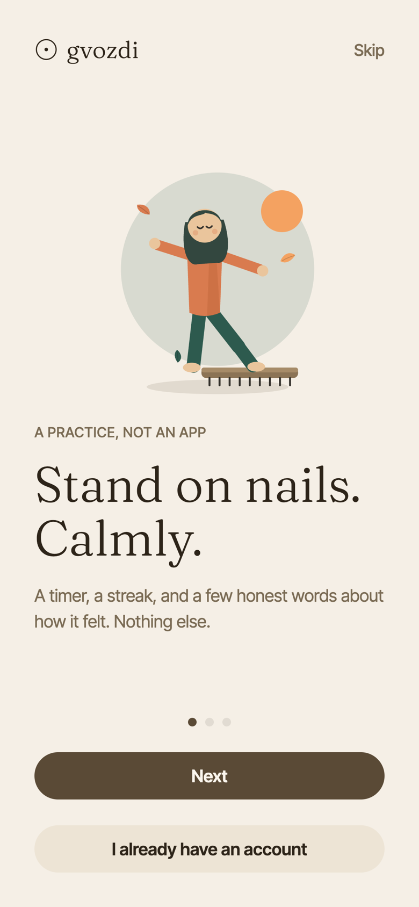
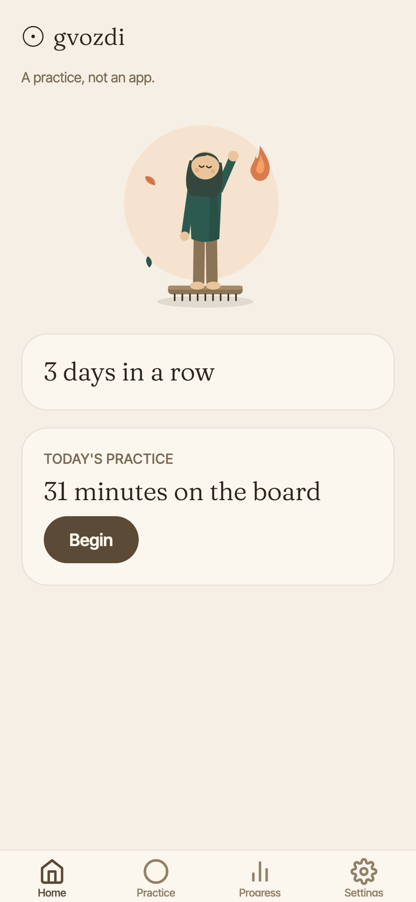
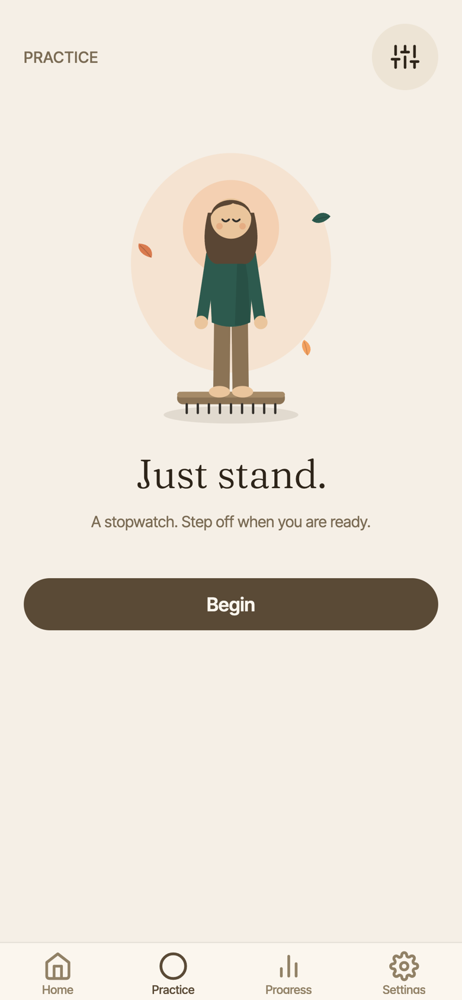
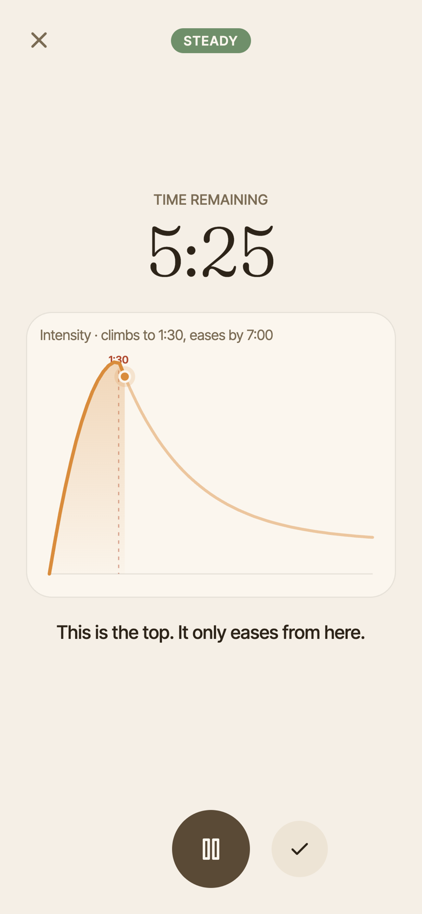
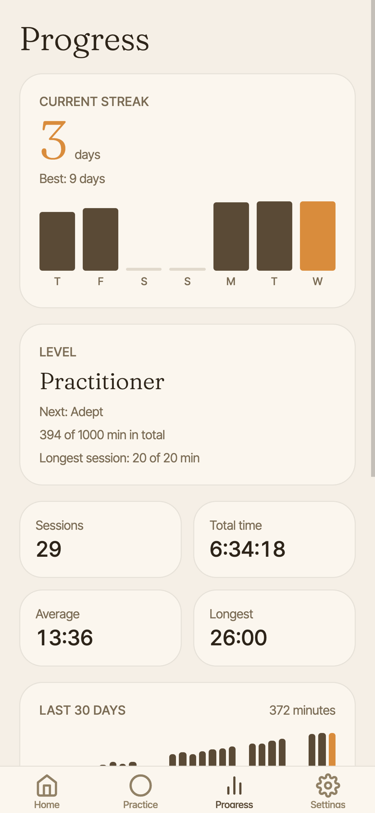
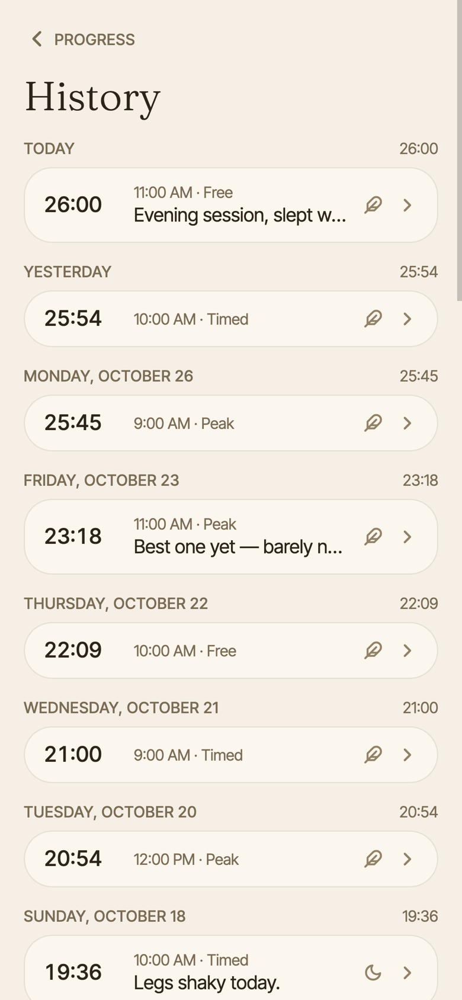

# Gvozdi

A calm companion for nail-board (Sadhu board) practice. One Expo codebase ships to iOS, Android and the web (PWA), in English, Ukrainian and Russian.

- Web: https://gvozdi.expo.app
- Live iOS simulator: https://appetize.io/app/b_lyoma6htlukdtl3kzqkvycxcte
- Every push to `main` deploys the PWA and publishes an OTA update to native builds (`.github/workflows/ship.yml`).

| | | |
|:-:|:-:|:-:|
|  |  |  |
|  |  |  |

## Features

**Practice**
- Zen start: the Practice tab opens on a free stopwatch session one tap away; the corner button reveals modes and minutes.
- Three modes: **Peak** (an intensity curve that climbs to 1:30 and eases by 7:00, with captions for each phase), **Timed** (a countdown ring to your goal) and **Free** (a stopwatch).
- Preset and custom durations (1–90 min); the suggested length follows a 21-day program.
- A prepare screen before you step on; keep-awake, a gong and haptics when the goal is reached, and a notification on a locked screen (native).
- Timers are timestamp-based, so a session survives backgrounding, screen lock, a reload or the OS killing the app, and resumes from Home.
- After a session, rate how intense it felt and leave a note, or discard it.

**Progress**
- Streak, totals and minutes-per-day charts.
- Achievements with an unlock screen after the session that earns one, plus levels.
- History grouped by day, with edit and delete.

**Everything else**
- Email-code account that syncs sessions across devices; guests can try one demo session first.
- Daily reminders (native) that skip days you've already practised.
- Export and import a JSON backup; clear all data.
- Light and dark themes, illustrated onboarding, installable PWA with offline support.
- Anonymous, opt-in usage stats (PostHog EU); consent is asked in the EU/EEA/UK/CH.

## Stack

Expo SDK 58 · Expo Router · react-native-web · TypeScript · Zustand · i18next · Reanimated · react-native-svg · Clerk · Drizzle + Neon (Postgres) · PostHog · EAS Hosting / Update.

## Development

```bash
npm install
npx expo start                                  # dev server (press w for web)
npm run typecheck && npm run lint && npm test   # run before every commit
```

Accounts and sync need `.env.local` with `EXPO_PUBLIC_CLERK_PUBLISHABLE_KEY`, `CLERK_SECRET_KEY` and `DATABASE_URL`.

```bash
npm run db:generate && npm run db:migrate       # schema changes (src/server/db.ts)
npm run db:seed -- <clerk user id>              # 5 weeks of sample sessions for a test account
```

See [AGENTS.md](AGENTS.md) for the project layout, conventions and gotchas.
